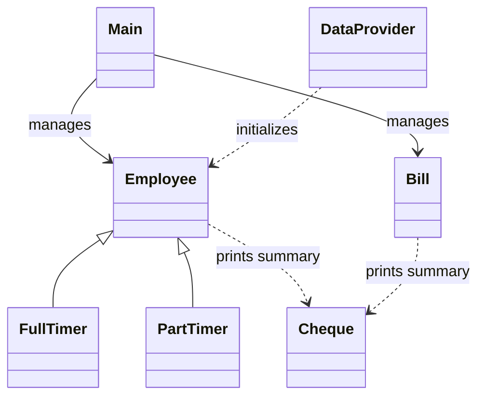

# Accounts Payable

A Java console application demonstrating basic accounts payable workflows and object-oriented programming. It maintains employee and bill records during a program session, calculates monthly employee salaries, and prints sequential cheque summaries.

## Features

- Starts with five full-time and five part-time sample employees.
- Add full-time employees with an annual salary or part-time employees with an hourly rate tier and monthly hours.
- Calculate monthly pay: annual salary divided by 12 for full-time employees, or hourly rate multiplied by monthly hours for part-time employees.
- Add bills with a company name, amount, and due date.
- Print cheque summaries for registered employees and bills, with a shared sequential cheque number.

The cheque output is text generated by the application. Employee and bill records are held in memory and are reset when the application is restarted.

## Design

`Employee` defines the shared employee data and monthly salary contract. `FullTimer` and `PartTimer` provide the two salary calculations, and `Main` uses the common `Employee` type when printing cheque summaries. `Bill` represents a company bill, while `Cheque` formats cheque output for employees and bills. `DataProvider` initializes the sample employees.



&nbsp;

## Project structure

```
.
├── src/
│   ├── Main.java
│   ├── Employee.java
│   ├── FullTimer.java
│   ├── PartTimer.java
│   ├── Bill.java
│   ├── Cheque.java
│   └── DataProvider.java
├── tests/
│   └── SalaryCalculationChecks.java
└── README.md
```

## Requirements

- JDK 8 or later
- No external libraries are required; the application uses Java standard-library classes.

## Build and run

From the repository root, compile the sources and run the menu application.

### Windows PowerShell

```powershell
New-Item -ItemType Directory -Force out | Out-Null
$javaSources = Get-ChildItem src -Filter *.java | ForEach-Object FullName
javac -d out $javaSources
java -cp out Main
```

&nbsp;

### macOS or Linux

```sh
mkdir -p out
javac -d out src/*.java
java -cp out Main
```

The menu options are: `1` add an employee, `2` add a bill, `3` print cheque summaries, and `4` exit. Part-time employees use echelon levels 1–5. Bill due dates are entered as `DD MM YYYY`.

## Salary examples

- A full-time employee with an annual salary of `60000` has a calculated monthly salary of `5000`.
- A part-time employee at echelon 3, which uses an hourly rate of `25`, working 160 hours has a calculated monthly salary of `4000`.

## Salary calculation checks

The lightweight checks use only the JDK and cover the full-time formula and all five part-time hourly-rate tiers.

### Windows PowerShell

```powershell
New-Item -ItemType Directory -Force out | Out-Null
$javaSources = Get-ChildItem src -Filter *.java | ForEach-Object FullName
javac -d out $javaSources tests\SalaryCalculationChecks.java
java -cp out SalaryCalculationChecks
```

&nbsp;

### macOS or Linux

```sh
mkdir -p out
javac -d out src/*.java tests/SalaryCalculationChecks.java
java -cp out SalaryCalculationChecks
```

&nbsp;